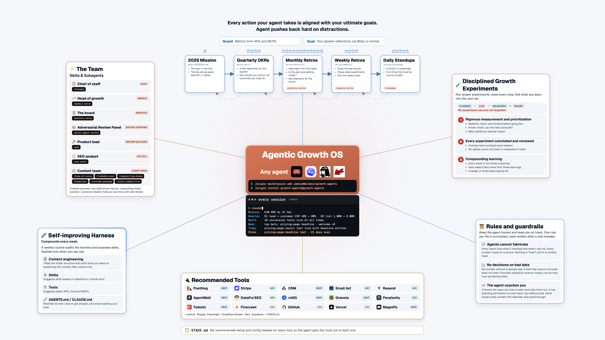

# growth-agents

**Install this and every Claude Code session opens with your goals, this week's bets and the experiment you have let slip. When you drift, it pushes back.**

James McAulay ran his startup on this exact setup and took it from inception to £100k+ months in 96 days. This repo is that setup with his business data taken out, ready for yours.

Before you type a word, Claude Code tells you where you stand (example files shown):

```
Mission   £1M ARR by 31 Dec
Quarter   O1 Lift lead → customer conversion from 10% to 20% · O2 Grow the email list from 1,000 to 2,000
Month     Ten conversion tests live at all times, none past its window.
Week      Pricing-page headline test live by Tuesday (KR1.1) · Publish Tuesday before opening the product rep…
Today     Pricing-page headline test live with its baseline written
Stale     EXAMPLE-live-stale · 21 days over (example)
```

That last line is the point. The stale experiment comes back every session, and `/weekly-retro` refuses to score the week until it has a result or a written kill.



## What Claude Code does differently from your first week

| | Claude Code on its own | Claude Code with growth-agents |
|---|---|---|
| **Starting a session** | A blank prompt. It does whatever you ask first, even when that is a distraction. | It opens with your mission, this week's bets, tonight's must-do and anything overdue, and it says so when an ask serves none of them. |
| **Experiments** | A test goes live and quietly expires. Three weeks later nobody can say whether it worked. | Nothing goes `live` without a baseline, a metric and a window. No A/B test without a power check. Anything past its window is chased every session until it is measured or killed. |
| **Goals** | The annual goals sit in a doc you reopen in December. | Mission and annual goals → quarter OKRs → 2–3 bets a week → one thing that must be true by tonight. Next morning opens with the verdict. A slip that repeats becomes a bet, not a to-do. |
| **Your tools** | You paste numbers from five tabs into the chat. | The standup reads your calendar, tasks, inbox and experiments through the tools you connect. Fourteen skills, one plugin. |
| **Shipping** | One pass, and you find the holes after launch. | The critic bench runs 3–4 sceptical sub-agents before anything ships. |
| **Mistakes** | You correct the same thing every week. | Every rule cites the incident that created it. A weekly prompt proposes edits to its own instructions; you say yes or no. |
| **Numbers** | It writes "conversion up 12%" and you cannot tell where that came from. | Every report ends with a ledger of what was checked. Every retro line is `observed`, `asked` or `unobserved`. Readouts are yours to type; the agent makes sure you do. |

## Install it in two minutes, inside Claude Code

1. `/plugin marketplace add JamsusMaximus/growth-agents`
2. `/plugin install growth-agents@growth-agents`
3. Open Claude Code in the folder where your goals and experiments will live. The first session prints the example briefing above, with a nudge to run `/growth-setup`.
4. Type `/growth-setup`. Rapid mode takes five minutes and five questions; full mode is an hour-long interview on your goals. It reads what is already in the folder first, picks a role profile (solo, growth lead, product marketing, SEO, content) and writes your mission, OKRs, derailers and first experiment. Then `/standup` each morning.

Prefer to clone? `git clone`, open the folder in Claude Code, and the same hook runs from `.claude/settings.json`.

## Seven roles run your week, each one a skill you invoke

Roles, never people. Full roster with what each reads and writes: [ROSTER.md](ROSTER.md).

| Role | Skill | When |
|---|---|---|
| Onboarding | `/growth-setup` | once, then each quarter |
| Chief of staff | `/standup` | every working day |
| Head of growth | `/weekly-retro` | every Friday |
| The board | `/monthly-retro` | first week of the month |
| Critic bench | `/multi-agent-refine` | before anything ships |
| Product lead | `/prd` | before anything is built |
| On call | `/seo-audit`, `/tone-of-voice`, `/linkedin-post`, `/copywriting-hooks`, `/humanizer`, `/youtube-package`, `/vidiq-competitive`, `/skill-iterator` | when you ask |

**The engine** (written for this repo): [`growth-setup`](skills/growth-setup/SKILL.md), `morning-standup`, `weekly-retro`, `monthly-retro`, `multi-agent-refine`, [`prd`](skills/prd/SKILL.md), `tone-of-voice`, `linkedin-post`.

**Installed alongside, credited:** `seo-audit` (Corey Haines, MIT, pinned at the version the scripts were written against), `copywriting-hooks` (samber, MIT), `humanizer` (blader, MIT), `youtube-package` and `vidiq-competitive` (re-authored here; need the vidIQ MCP), [`skill-iterator`](skills/skill-iterator/SKILL.md) (how to add a hire of your own; builds on Anthropic's skill-creator). The `/standup` and `/growth-setup` aliases live in [commands/standup.md](commands/standup.md) and [commands/growth-setup.md](commands/growth-setup.md).

## Each folder holds one part of the system

| Folder | What it is | Start with |
|---|---|---|
| `experiments/` | One folder, one template, one lifecycle: `planned → live → measured` or `killed`. The three rules the whole system enforces. | `experiments/README.md` |
| `goals/` | The year in one line plus the annual goals behind it; quarterly OKRs from behaviours you control; your derailers, the agent's coaching notes on how you lose a week. | `goals/MISSION.md` |
| `retros/` | Daily, weekly, monthly templates plus the compounding ledger: what now pays off with your hands off it. | `retros/weekly/TEMPLATE.md` |
| `principles/` | One file per rule, each with the incident that created it. | `principles/README.md` |
| `stack/` | Twenty-one tools, one page each: what for, MCP or API or CLI, setup, quirks. Vendor names live here and nowhere else. | `STACK.md` |
| `reference/` | The self-improvement prompt, path-scoped rules with the check that proves they load, a link checker. | `reference/README.md` |

## You can use this at work, for yourself and inside your team

CC BY-NC 4.0 on the original work here rules out reselling the templates; vendored skills keep their own MIT licences. See `LICENSES.md`.

## Coming in v1.1: the chase fetches the number for you

A readout adapter for one analytics tool, so the chase can also fetch the number.

Built by James McAulay, who teaches this at [agentaccelerator.ai](https://agentaccelerator.ai/?ref=growth-agents).

## Related

- [ROSTER.md](ROSTER.md) - the hires
- [GLOSSARY.md](GLOSSARY.md) - the fixed vocabulary every file uses
- [CLAUDE.md](CLAUDE.md) - the read order and the standing rules for the agent
- [experiments/README.md](experiments/README.md) - the spine that chases
- [principles/README.md](principles/README.md) - the rules and their incidents
