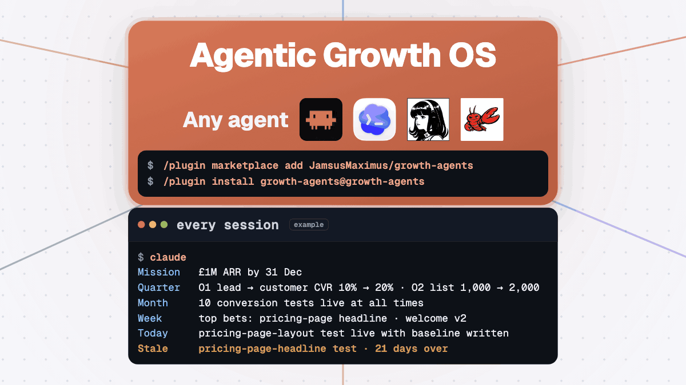

<p align="center">
  
</p>

<h2 align="center">The Agentic Growth OS for your coding agent: growth skills, routines that hold you to your goals, pattern-spotting on how you work, and the tools to run it all.</h2>

<p align="center">James McAulay used this setup to take his startup from inception to <b>£100k+ months in 96 days</b>.<br>This repo is the same setup with his business data removed.</p>

<p align="center"><b>Works with any coding agent</b></p>

<p align="center">
  &nbsp;&nbsp;
  &nbsp;&nbsp;
  &nbsp;&nbsp;
  
  <br>
  <sub>Claude Code · Codex · Hermes · OpenClaw</sub>
</p>

<p align="center">
  <a href="#install-growth-agents-and-set-up-your-first-week-in-five-minutes">Install</a> ·
  <a href="#what-changes-once-growth-agents-is-installed">What changes</a> ·
  <a href="#an-overdue-experiment-comes-back-every-session-because-james-once-left-one-live-for-ten-weeks">Why</a> ·
  <a href="#seven-roles-run-your-week-and-each-one-is-a-skill">Roles</a> ·
  <a href="#it-needs-no-code-and-never-sends-anything-for-you">Questions</a>
</p>

<p align="center">
  
  <br>
  <sub><a href="assets/growth-agents-blueprint.png">Open the full-size diagram</a></sub>
</p>

## Install growth-agents and set up your first week in five minutes

In Claude Code:

```
/plugin marketplace add JamsusMaximus/growth-agents
/plugin install growth-agents@growth-agents
```

On Codex or another coding agent, clone this repo and open the folder in your agent.

1. Open your agent in the folder where your goals and experiments will live. The first session prints a briefing from the example files, with an example experiment 21 days past its window flagged as stale.
2. Run `/growth-setup`. Rapid mode asks five questions and takes about five minutes. Full mode is an hour-long interview on your goals.
3. Check the files it writes: your mission, OKRs, derailers and first experiment. It reads your folder first and picks a profile (solo, growth lead, product marketing, SEO or content).
4. Run `/standup` each morning.

## What changes once growth-agents is installed

| | Your coding agent on its own | Your coding agent with growth-agents |
|---|---|---|
| 🌅 **Starting a session** | A blank prompt. It does whatever you ask first, even when that is a distraction. | It opens with your mission, this week's bets, the one thing that must be true by tonight and anything overdue. If a request serves none of them, it tells you. |
| 🧪 **Experiments** | A test goes live and quietly expires. Three weeks later nobody can say whether it worked. | An experiment cannot go `live` until its baseline, metric and window are written down. An A/B test needs a power check first. Anything past its window comes back every session until it is `measured` or `killed`. |
| 🎯 **Goals** | The annual goals sit in a doc you reopen in December. | Mission → quarter OKRs → 2–3 bets a week → one thing that must be true by tonight. The next morning opens with the verdict. A slip that repeats becomes one of next week's bets. |
| 🔌 **Your tools** | You paste numbers from five tabs into the chat. | The standup reads your calendar, tasks, inbox and experiments through the tools you connect. |
| 🚢 **Shipping** | One pass, and you find the holes after launch. | The critic bench runs 3–4 sceptical sub-agents before anything ships. |
| 🔁 **Mistakes** | You correct the same thing every week. | Every rule cites the incident that created it. Each week a self-improvement prompt proposes edits to the rules, and you approve or reject each one. |
| 📏 **Numbers** | It writes "conversion up 12%" and you cannot tell where that came from. | Every report ends with a coverage ledger of what was checked. Every retro line is labelled `observed`, `asked` or `unobserved`. You type each result yourself, and it keeps asking until you do. |

## An overdue experiment comes back every session because James once left one live for ten weeks

The baseline was written down and the metric was fixed up front. Then the window closed and nobody opened the file for ten weeks. The test produced no result anyone could use.

That is why rule 2 exists. An experiment past its window is named at the start of every session. `/weekly-retro` will not score the week until that experiment is `measured` or `killed`. The full story is in [experiments/README.md](experiments/README.md).

## Seven roles run your week, and each one is a skill

What each role reads and writes: [ROSTER.md](ROSTER.md).

| Role | Skill | When |
|---|---|---|
| 🧭 Onboarding | `/growth-setup` | once, then each quarter |
| ☕ Chief of staff | `/standup` | every working day |
| 📈 Head of growth | `/weekly-retro` | every Friday |
| 🏛️ The board | `/monthly-retro` | first week of the month |
| ⚖️ Critic bench | `/multi-agent-refine` | before anything ships |
| 📋 Product lead | `/prd` | before anything is built |
| 📟 On call | `/seo-audit`, `/tone-of-voice`, `/linkedin-post`, `/copywriting-hooks`, `/humanizer`, `/youtube-package`, `/vidiq-competitive`, `/skill-iterator` | when you ask |

## It needs no code and never sends anything for you

- **Do I need to code?** No. Everything is Markdown files and slash commands.
- **Will it email or post on my behalf?** No. The agent has no send capability. It drafts, and you send.
- **I already have a task manager.** Keep it. The standup reads your tasks through the tools you connect. `stack/todoist.md` shows one setup.
- **Does it only work in Claude Code?** No. It runs on Codex and other coding agents too. The plugin commands above are the quick install for Claude Code.
- **Can I use it at work?** Yes, for yourself and inside your team. The CC BY-NC 4.0 licence rules out reselling the templates. See `LICENSES.md`.

## Your goals, experiments and retros live in six plain folders

| Folder | What it holds | Start with |
|---|---|---|
| `experiments/` | One file per experiment, moving `planned → live → measured` or `killed`, plus the three rules the skills enforce. | `experiments/README.md` |
| `goals/` | Your mission, quarterly OKRs and derailers (the agent's notes on how you lose a week). | `goals/MISSION.md` |
| `retros/` | Daily, weekly and monthly templates, plus the compounding ledger of what now pays off without you. | `retros/weekly/TEMPLATE.md` |
| `principles/` | One file per rule, each with the incident that created it. | `principles/README.md` |
| `stack/` | Twenty-one tool pages: what each is for, MCP or API or CLI, setup and quirks. | `STACK.md` |
| `reference/` | The self-improvement prompt, path-scoped rules and a link checker. | `reference/README.md` |

## Eleven skills were written for this repo and three are vendored from credited authors

**Written here:** [`growth-setup`](skills/growth-setup/SKILL.md), `morning-standup`, `weekly-retro`, `monthly-retro`, `multi-agent-refine`, [`prd`](skills/prd/SKILL.md), `tone-of-voice`, `linkedin-post`, `youtube-package` and `vidiq-competitive` (both need the vidIQ MCP), and [`skill-iterator`](skills/skill-iterator/SKILL.md) (how to add a role of your own; builds on Anthropic's skill-creator).

**Vendored, MIT:** `seo-audit` (Corey Haines, pinned at the version the scripts were written against), `copywriting-hooks` (samber) and `humanizer` (blader). Each keeps its own licence; details in `LICENSES.md`. The `/standup` and `/growth-setup` aliases live in [commands/standup.md](commands/standup.md) and [commands/growth-setup.md](commands/growth-setup.md).

Built by James McAulay, who teaches this at [agentaccelerator.ai](https://agentaccelerator.ai/?ref=growth-agents).

## Related

- [ROSTER.md](ROSTER.md) - who does what
- [GLOSSARY.md](GLOSSARY.md) - the fixed vocabulary every file uses
- [CLAUDE.md](CLAUDE.md) - the read order and the standing rules for the agent
- [experiments/README.md](experiments/README.md) - the spine that chases
- [principles/README.md](principles/README.md) - the rules and their incidents
